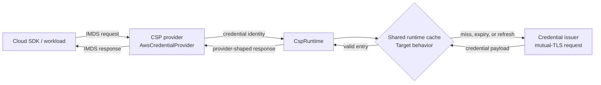
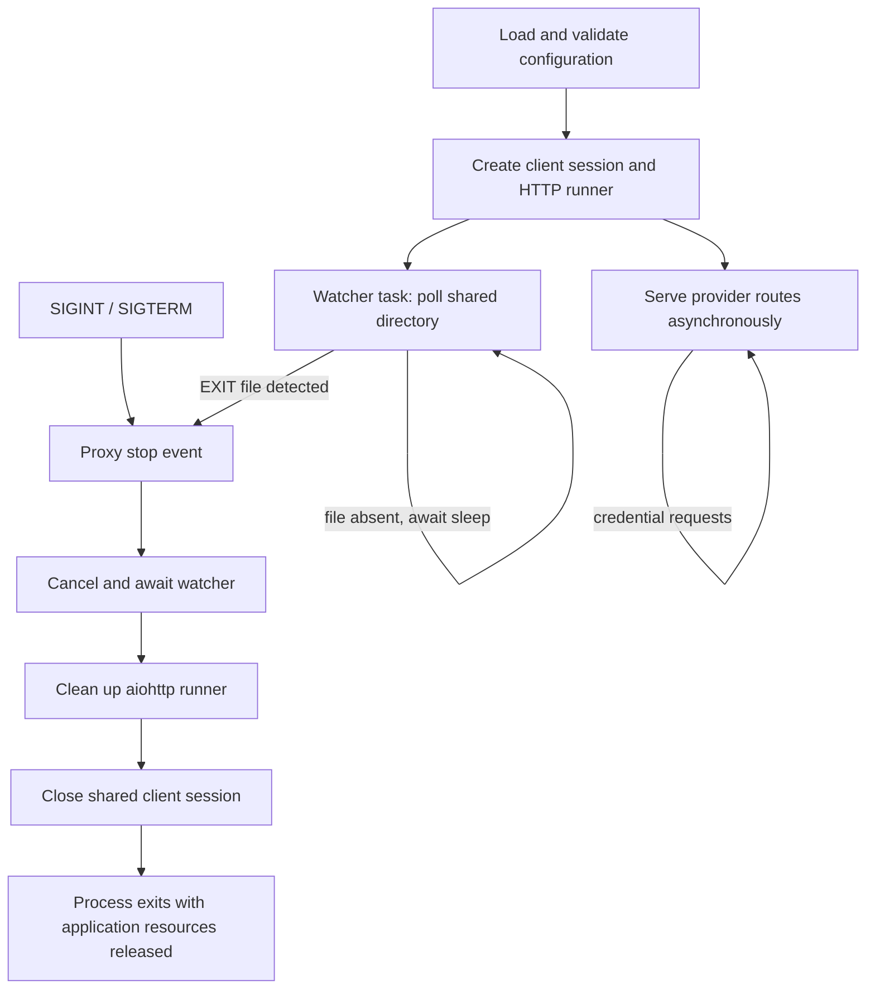

# PKI Pivot Proxy Architecture

This document is the target architecture for PKI Pivot. The
proxy presents cloud-provider metadata endpoints to workloads and uses a PKI
client certificate to retrieve credentials from a configured issuer. AWS is the
first provider; the provider/runtime split is intended to support additional
CSPs without putting CSP-specific protocol behavior in the HTTP server.

> **Status convention:** sections labeled **Current implementation** describe
> the repository today. Sections labeled **Target architecture** describe the
> intended design and may name configuration or behavior that has not yet been
> implemented.

## Component boundaries

### Current implementation

- `src/pki_pivot/http_proxy.py` owns `CredentialProxy`, proxy-wide
  configuration loading, the `aiohttp` application and runner, the shared
  `aiohttp.ClientSession`, signal registration, the stop event, and the
  exit-file watcher. It also adds the `GET /health` endpoint.
- `src/pki_pivot/csp_token_requester/base.py` defines the CSP boundary:
  `CredentialProvider` owns a CSP's routes and response shaping;
  `ProxyRuntime` is the provider-facing protocol; `CspConfig` holds validated
  CSP-scoped issuer, organization-label, and TLS settings and derives the
  issuer path (`issuer_path()`) and query parameters (`issuer_params()`); and
  `CspRuntime` makes the issuer request using the shared client session and
  that CSP's TLS context, through a per-runtime credential cache.
- `src/pki_pivot/csp_token_requester/aws.py` implements
  `AwsCredentialProvider`. It serves the IMDSv2 token endpoint, the IAM role
  discovery endpoint, and the role-credential endpoint. A valid credential
  request calls `CspRuntime.fetch_credentials()` with the configured issuer
  path and `CspConfig.issuer_params()`; failures are logged and returned as
  HTTP `502`.
- `src/pki_pivot/csp_token_requester/csp.py` currently registers only the
  `AWS` CSP token. Provider registration in `base.py` makes future providers
  explicit rather than special cases in `CredentialProxy`.

### Target architecture

`CredentialProxy` remains CSP-agnostic: it validates shared settings, creates
one `CspRuntime` for each configured CSP, and wires the registered provider's
routes to that runtime. A provider remains responsible for metadata-route
semantics and its external response shape. For example, AWS continues to own
IMDSv2 token and role-list responses as well as mapping issuer errors to its
IMDS-compatible `502` response.

Each `CspRuntime` owns a credential cache shared by all of its provider routes.
The runtime is the cache boundary because it already scopes issuer URL,
mutual-TLS identity, organization, account, and role configuration to one CSP.
This centralizes expiry and concurrent-request behavior without making those
concerns AWS-specific.

A cache key identifies the credential identity within the CSP runtime. It must
include the CSP and every identity input that can select different credentials;
for the current AWS flow that is the configured organization, account ID, IAM
role name, issuer path, and issuer request parameters (including the
organization-label parameter). A future provider must supply a key containing
its own credential-identity inputs. Keys must not be shared between CSPs or
between credential identities merely because their serialized issuer responses
happen to look alike.

For a key, the target cache contract is:

1. A non-expired entry returns its credential payload without issuer I/O.
2. A missing or expired entry starts one asynchronous issuer retrieval.
   Concurrent callers for the same key await that in-flight retrieval rather
   than starting duplicate issuer calls.
3. A successful retrieval replaces the entry and its expiry.
4. A failed retrieval is removed from any in-flight state and is not cached.
   The provider maps the resulting error exactly as it does for a direct issuer
   failure (currently AWS returns `502`).



## Configuration contract

### Current implementation

`ProxyConfig` in `src/pki_pivot/http_proxy.py` validates server-wide settings
and creates one `CspConfig` per entry in required `TARGET_CSPS`. A CSP's
issuer URL, organization, account ID, IAM role name, issuer path template,
issuer timeout, and TLS files use the uppercase CSP prefix (for example,
`AWS_ISSUER_URL` and `AWS_TLS_CERT_FILE`). The existing defaults include
`HTTP_BIND_HOST=localhost`, `HTTP_PORT=8080`, `SHARED_DIR=/shared`,
`EXIT_FILE_NAME=EXIT`, `EXIT_CHECK_INTERVAL=500`, and
`CREDENTIAL_CACHE_TTL_MINUTES=55`.

The organization is also sent to the issuer as a query parameter,
`?<label>=<organization>`. The label defaults to `organization`, can be set
for all CSPs with `ORGANIZATION_LABEL`, and is overridden per CSP by
`<CSP>_ORGANIZATION_LABEL`. Labels are trimmed and lower-cased, must match
`[a-z_][a-z0-9_.-]*`, and the values `none`, `null`, or `-` disable the
parameter.

Startup validation fails fast, in this order:

1. `TARGET_CSPS` unset or empty: the error states that it is not defined and
   lists the supported CSPs.
2. A listed CSP has no registered provider.
3. Required CSP-prefixed variables are missing or blank: one error lists every
   missing pairing, for example `CSP AWS: AWS_ACCOUNT_ID; CSP AWS:
   AWS_TLS_KEY_FILE`.
4. Present but invalid values, such as the issuer URL, role path segment, path
   template, unreadable TLS files, or a malformed organization label.

### Target configuration

<table>
  <thead>
    <tr><th>Setting</th><th>Default</th><th>Scope</th><th>Target contract</th></tr>
  </thead>
  <tbody>
    <tr><td><code>CREDENTIAL_CACHE_TTL_MINUTES</code></td><td><code>55</code></td><td>Proxy-wide cache policy</td><td>Integer number of minutes (1–1440) for successful credential-cache entries. <code>CspRuntime</code> applies the same configured duration to entries for its CSP.</td></tr>
    <tr><td><code>TARGET_CSPS</code></td><td>none</td><td>Provider selection</td><td>Required comma-separated, case-insensitive CSP list; an unset or empty value is a fatal error. Every configured CSP must have a registered provider.</td></tr>
    <tr><td><code>CSP_PREFIX_ISSUER_URL</code>, <code>CSP_PREFIX_ORGANIZATION</code>, <code>CSP_PREFIX_ACCOUNT_ID</code>, <code>CSP_PREFIX_IAM_ROLE_NAME</code></td><td>none</td><td>CSP identity</td><td>Required inputs for the CSP-specific issuer request and credential identity. All missing CSP/variable pairings are reported together in one fatal error.</td></tr>
    <tr><td><code>ORGANIZATION_LABEL</code>, <code>CSP_PREFIX_ORGANIZATION_LABEL</code></td><td><code>organization</code></td><td>CSP issuer request</td><td>Name of the issuer query parameter carrying the organization (e.g. <code>org</code>). The CSP-prefixed value overrides the global one; values are lower-cased; <code>none</code>, <code>null</code>, or <code>-</code> disable the parameter.</td></tr>
    <tr><td><code>CSP_PREFIX_TLS_CERT_FILE</code>, <code>CSP_PREFIX_TLS_KEY_FILE</code>, <code>CSP_PREFIX_TLS_CA_FILE</code></td><td>CA file optional</td><td>CSP transport</td><td>Client-certificate and trust material for an HTTPS issuer. Certificate and key are required and must be readable files.</td></tr>
    <tr><td><code>CSP_PREFIX_ISSUER_PATH_TEMPLATE</code>, <code>CSP_PREFIX_ISSUER_TIMEOUT</code></td><td>implementation defaults</td><td>CSP issuer request</td><td>Preserve the existing per-CSP issuer path and timeout controls.</td></tr>
    <tr><td><code>SHARED_DIR</code></td><td><code>/shared</code></td><td>Process lifecycle</td><td>Directory containing the external shutdown file; detailed watcher behavior is defined below.</td></tr>
    <tr><td><code>EXIT_FILE_NAME</code></td><td><code>EXIT</code></td><td>Process lifecycle</td><td>Single path-segment filename joined to <code>SHARED_DIR</code>; detailed watcher behavior is defined below.</td></tr>
    <tr><td><code>EXIT_CHECK_INTERVAL</code></td><td><code>500</code> milliseconds</td><td>Process lifecycle</td><td>Positive polling interval expressed in milliseconds. The target watcher converts it with <code>interval_ms / 1000</code> before calling <code>asyncio.sleep</code>.</td></tr>
    <tr><td><code>EXIT_CHECK_DISABLED</code></td><td><code>false</code></td><td>Process lifecycle</td><td>Disables external exit-file monitoring without disabling signal shutdown.</td></tr>
  </tbody>
</table>

## Extension model

To add a CSP, implement and register a `CredentialProvider`, define its
metadata routes and response mapping, and use the supplied `ProxyRuntime` for
issuer access. The provider contributes its credential identity to the
runtime-level cache key; it does not reimplement cache expiry or in-flight
coalescing. This preserves one cache and issuer-lifecycle contract while
allowing each cloud's metadata protocol to remain independent.

## Operational lifecycle

### Current implementation

`CredentialProxy.serve_until_stopped()` in
`src/pki_pivot/http_proxy.py` starts the server, registers `SIGINT` and
`SIGTERM` handlers when the platform supports them, and waits on its stop
event. Its `finally` block calls `stop()`, which sets that event, cancels and
awaits the watcher task, cleans up the `aiohttp` runner, and closes the shared
client session. No worker threads are created by the proxy; HTTP serving and
file watching are tasks on the same event loop.

`start()` creates the client session, builds provider routes, starts the
`aiohttp` site, and creates the watcher unless `EXIT_CHECK_DISABLED` is true.
It warns, but continues, when `SHARED_DIR` does not exist. The watcher also
tolerates a directory that disappears after startup by skipping checks and
warning once until the directory reappears.

### Target shutdown contract

All shutdown sources use one stop-event path:

- `SIGINT` (`CTRL+C`) and `SIGTERM` call the proxy shutdown request method.
- Detecting `<SHARED_DIR>/<EXIT_FILE_NAME>` requests the same stop event.
- Once the event is set, no new watcher iteration is needed. The serving
  coroutine cancels and awaits the watcher before cleaning up the runner and
  closing the shared client session.

The watcher is independent from request handling. Its polling loop checks for
the configured file, then yields with `await asyncio.sleep(interval_ms / 1000)`.
Therefore an AWS request can be served while the watcher is asleep, and
cancellation of the watcher is not blocked by polling. A missing shared
directory is a non-fatal condition: continue serving credentials and retry on
later polling iterations.



## Operational use cases

### Start and validate configuration

1. An operator provides `TARGET_CSPS` and the required CSP-prefixed issuer,
   identity, and TLS-file settings. Optional shared settings override their
   defaults, including `SHARED_DIR=/shared`, `EXIT_FILE_NAME=EXIT`, and
   `ORGANIZATION_LABEL=organization`.
2. `load_config()` validates the selected CSPs, provider registration, the
   presence of every required CSP-prefixed variable, then the issuer URL, role
   path segment, path template, readable TLS files, and organization label.
   Invalid values stop startup with a configuration error (process exit with
   `Configuration error: …`) rather than starting a partial proxy.
3. The entry point creates each issuer TLS context, then starts
   `CredentialProxy`. Providers register their routes and the server starts
   serving only after this configuration is ready.

### AWS IMDSv2 credential delivery

1. An AWS SDK sends `PUT /latest/api/token`; `AwsCredentialProvider` returns
   its IMDSv2 token response.
2. The SDK sends `GET /latest/meta-data/iam/security-credentials/`; the
   provider returns the configured IAM role name.
3. The SDK requests
   `GET /latest/meta-data/iam/security-credentials/{role}`. A role other than
   the configured role receives `404`; the configured role is resolved through
   its `CspRuntime`, which requests
   `<ISSUER_URL><issuer path>?<organization label>=<organization>` (no query
   parameter when the label is disabled), and the result is returned in the
   provider's JSON response format.

### Credential cache miss, hit, and refresh

1. On a cache miss, `CspRuntime` records one in-flight issuer retrieval for
   the CSP-scoped credential key. Other matching requests await that work.
2. When the issuer returns credentials, the runtime stores them for
   `CREDENTIAL_CACHE_TTL_MINUTES` (default `55`) and responds to all waiting
   requests.
3. A request made before expiry is a cache hit and returns the stored payload
   without issuer I/O.
4. On expiry, the first caller refreshes the entry while concurrent callers
   coalesce with that refresh; its successful result starts a new TTL.

### Upstream issuer failure

When issuer TLS, timeout, transport, JSON, or HTTP-status processing fails,
the runtime does not retain either an error result or a failed in-flight entry.
The provider retains responsibility for protocol-specific error mapping. The
current AWS provider logs the failure and returns HTTP `502 Upstream credential
provider error`; the target cache design preserves that result for a failed
miss or refresh.

### `CTRL+C`, `SIGINT`, and `SIGTERM`

1. A terminal `CTRL+C` produces `SIGINT`; an orchestrator may instead send
   `SIGTERM`.
2. The proxy's signal handler sets the same stop event used by file detection.
3. `serve_until_stopped()` exits its wait, then cancels and awaits the watcher,
   cleans up HTTP resources, and closes the issuer session. Thus an
   application-owned watcher task or session connection is not left running.

### External `EXIT` file

1. An external process creates `<SHARED_DIR>/<EXIT_FILE_NAME>`; by default
   this is `/shared/EXIT`. Either path element may be overridden through its
   named environment variable.
2. Unless `EXIT_CHECK_DISABLED=true`, the watcher checks that exact path at
   the configured positive `EXIT_CHECK_INTERVAL` in milliseconds, converting
   that number to seconds before sleeping.
3. On finding the file, the watcher sets the common stop event and returns.
   The normal shutdown sequence then releases the watcher, HTTP runner, and
   client session.

### Missing shared directory while serving

If `/shared` (or an overridden `SHARED_DIR`) is absent at startup or later,
the proxy logs a warning and continues to serve metadata and credentials. The
watcher skips only that iteration and retries after its non-blocking sleep, so
the directory may be created later without restarting the process. Signal
shutdown remains available throughout.
```